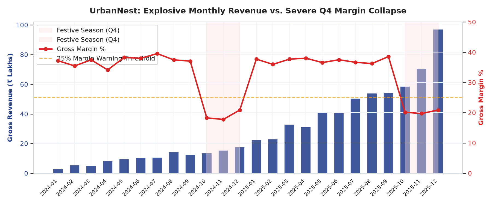
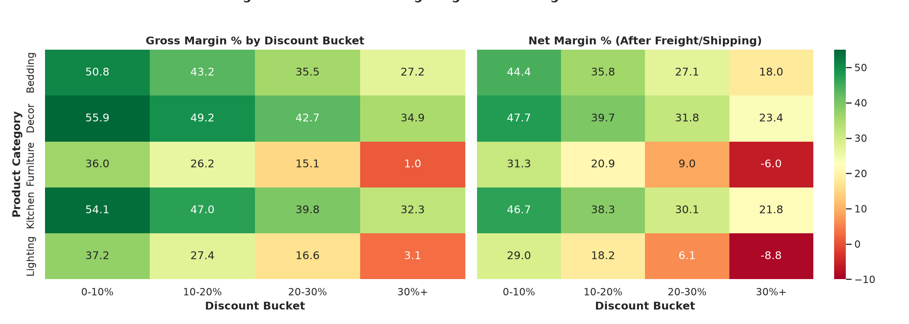
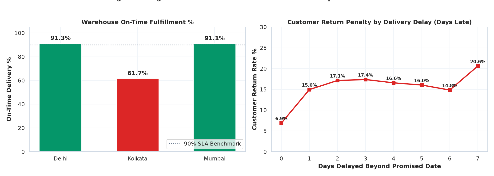
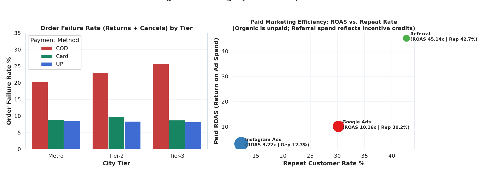
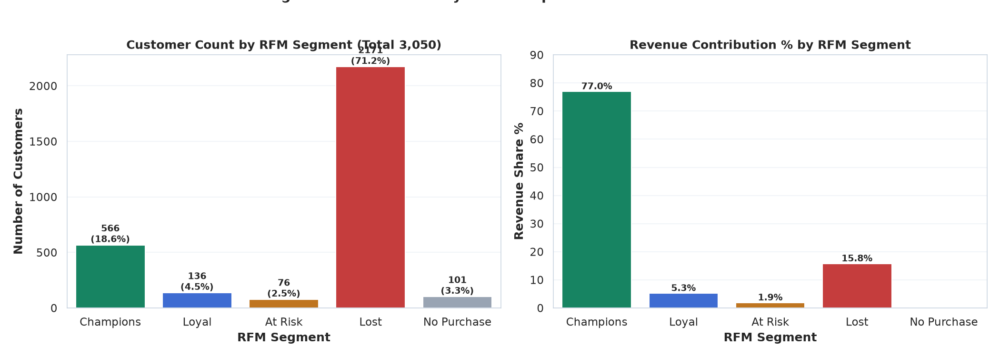

# Growth vs. Profit: Sales & Delivery Analytics for an Indian D2C Brand

[](https://www.python.org/)
[](https://duckdb.org/)
[](https://powerbi.microsoft.com/)
[](https://pandas.pydata.org/)
[](LICENSE)

An end-to-end commercial and operational analytics project for **UrbanNest**, a fictional Indian direct-to-consumer (D2C) home & lifestyle brand experiencing rapid top-line growth accompanied by margin compression. Built as a portfolio project demonstrating practical competencies in **SQL (DuckDB), Python, Power BI data modeling, DAX measures, and structured commercial insight generation**.

---

## 📌 Context & Business Problem

Between January 2024 and December 2025, **UrbanNest** scaled its operations across Metros, Tier-2, and Tier-3 Indian cities, expanding gross revenue from **₹13.55 Lakhs** in Q1 2024 to **₹226.26 Lakhs** in Q4 2025 (**₹7.03 Crores** cumulative gross bookings across 15,000 orders).

However, leadership identified that **operating profitability was failing to keep pace with sales growth**. Despite substantial festive Q4 revenue spikes, operating cash flow lagged significantly behind top-line expansion.

This project investigates the root causes of margin erosion across four analytical dimensions:
1. **Gross-to-Delivered Revenue Erosion:** Quantifying the cash lost between order booking and final delivery settlement.
2. **Seasonal Margin Dilution:** Diagnosing why Q4 festive sales compress gross and contribution margins.
3. **Logistics & Payment Risk:** Analyzing fulfillment bottlenecks across regional warehouses and default patterns across Cash-on-Delivery (COD) orders.
4. **Acquisition Quality vs. Churn:** Evaluating customer acquisition cost (CAC), return on ad spend (ROAS), and repeat purchase behavior across marketing channels.

---

## 🛠 Tech Stack & Architecture

- **Data Generation & Cleaning:** Python (`pandas`, `numpy`, `Faker`) with deterministic random seeds (Seed 42) incorporating realistic operational data quality patterns (deduplication, date parsing, status standardization).
- **Relational Analytics & SQL:** `DuckDB` running 6 strategic analytical queries utilizing CTEs, window functions (`LAG`), conditional aggregations (`CASE`), and multi-table joins.
- **Exploratory Data Analysis & Modeling:** Jupyter Notebook (`analysis.ipynb`) featuring data validation logs, exploratory visualizations, delivery latency decay curves, and an RFM customer segmentation model.
- **Power BI Assets:** Structured DAX measures repository (`measures.dax`) with 22 organized measures, complete Star Schema data model documentation (`data_model.md`), a 2-page dashboard layout specification (`dashboard_spec.md`), and an exact expected scalar benchmark (`expected_values.md`).
- **Audit & Validation Pipeline:** Python scripts in `checks/` ensuring every reported metric is computed directly from clean data without manual estimation.

---

## 📂 Project Structure

```
powerBiProject/
│
├── data/
│   ├── raw/                           # Raw synthetic CSVs (15,000 orders, 3,050 customers)
│   │   ├── customers.csv              # customer_id, city, city_tier, channel, signup_date
│   │   ├── products.csv               # 40 SKUs across 5 home & lifestyle categories
│   │   ├── orders.csv                 # 15,000 order transactions, pricing, shipping, SLA
│   │   └── marketing_spend.csv        # 24 monthly spend records across 4 channels
│   ├── processed/                     # Cleaned, star-schema CSVs ready for Power BI
│   │   ├── dim_customers.csv          # Standardized customer dimension (3,050 rows)
│   │   ├── dim_products.csv           # Clean product dimension catalog (40 SKUs)
│   │   ├── dim_date.csv               # Continuous date table (2024-01-01 to 2025-12-31)
│   │   ├── dim_channel.csv            # Acquisition channel bridge table (4 channels, is_paid flag)
│   │   ├── fact_orders.csv            # Clean orders fact table (15,000 rows)
│   │   ├── fact_marketing_spend.csv   # Normalized monthly marketing spend (96 rows)
│   │   └── customer_rfm.csv           # RFM scoring and 5-tier segment table (3,050 rows)
│   └── generate_data.py               # Reproducible data generator (Seed: 42)
│
├── sql/
│   ├── analysis_queries.sql           # 6 core diagnostic SQL queries (CTEs, LAG, aggregations)
│   └── run_sql.py                     # DuckDB ingestion, data cleaning pipeline & query executor
│
├── notebooks/
│   ├── analysis.ipynb                 # Fully executed diagnostic notebook with Markdown commentary
│   ├── generate_notebook.py           # Programmatic builder and runner for analysis.ipynb
│   └── figures/                       # High-resolution exported diagnostic charts
│       ├── revenue_vs_margin_trend.png
│       ├── discount_margin_heatmap.png
│       ├── logistics_return_penalty.png
│       ├── payment_and_channel_performance.png
│       └── rfm_segmentation_breakdown.png
│
├── powerbi/
│   ├── measures.dax                   # 22 DAX measures categorized into 6 display folders
│   ├── data_model.md                  # Star schema ERD (Mermaid) & relationship specifications
│   ├── dashboard_spec.md              # 2-page executive report wireframe, palette & visual mapping
│   └── expected_values.md             # Benchmark scalar values from DuckDB for report validation
│
├── checks/
│   ├── compute_metrics.py             # Single source of truth: generates metrics.json & reference doc
│   ├── whatif_estimates.py            # What-if sensitivity modeling for executive recommendations
│   └── generate_expected_values.py    # Generates expected_values.md directly from DuckDB
│
├── docs/
│   ├── executive_summary.md           # 1-page executive memo with quantified recommendations
│   ├── metrics_reference.md           # Master metrics reference table (single source of truth)
│   ├── metrics.json                   # Machine-readable single source of truth for all metrics
│   └── assumptions.md                 # Modeling assumptions, formulas, and baseline data notes
│
├── requirements.txt                   # Environment dependencies
└── README.md                          # Project documentation and build guide
```

---

## 🔍 Key Findings (Single Source of Truth)

Every figure below is derived directly from `docs/metrics.json` and verified against the DuckDB pipeline:

### 1. Revenue Scale & Gross-to-Delivered Erosion
- **Gross Revenue:** **₹7.03 Crores** (₹70,273,362 across 15,000 orders; Average Order Value: **₹4,685**).
- **Delivered Revenue:** **₹6.12 Crores** (₹61,230,825 across 13,095 delivered orders).
- **Revenue Erosion:** **₹0.90 Crores (₹90.43 Lakhs)** lost to order cancellations (712 orders, 4.75%) and customer returns (1,193 orders, 7.95%).
- **Operating Margins:** Blended Gross Margin stands at **30.60%** (COGS: ₹487.70L), while Contribution Margin after freight drops to **23.64%** (Freight: ₹48.90L).

### 2. Bulky Category Discounting & Festive Margin Compression
- In baseline non-festive quarters (Q1–Q3), gross margin remains consistent between **36.60% and 37.93%**.
- During Q4 festive promotions, heavy discount markdowns compress gross margin to **19.11% in 2024 Q4** and **20.34% in 2025 Q4**.
- Deep discounting (>30%) causes net contribution margin to turn negative in bulky categories:
  - **Furniture (>30% discount):** 688 orders generated ₹70.65L gross revenue at **0.93% gross margin** and **-6.05% net margin after freight**.
  - **Lighting (>30% discount):** 660 orders generated ₹16.79L gross revenue at **3.12% gross margin** and **-8.82% net margin after freight**.
- In contrast, lightweight parcels maintain positive margins across all discount tiers: **Decor** (40.97% net margin), **Kitchen** (39.37% net margin), and **Bedding** (37.03% net margin).

### 3. Payment Method & Geographic Default Risk
- Cash-on-Delivery (COD) orders (4,070 orders) exhibit a **23.44% failure rate** (13.59% returns + 9.85% cancellations), compared to **8.70% for prepaid orders** (5.86% returns + 2.85% cancellations).
- COD orders are empirically **2.69x more likely to fail** than prepaid transactions.
- In **Tier-3 cities**, COD failure reaches **25.61%** (12.30% pre-dispatch cancellations and 13.30% post-delivery returns), consuming shipping costs in both directions without realized revenue.

### 4. Fulfillment Latency: The Kolkata Warehouse Bottleneck
- **Delhi** (5,881 fulfilled shipments) and **Mumbai** (5,512 fulfilled shipments) operate at **91.29%** and **91.13%** on-time delivery rates, averaging **3.28 days** and **3.26 days** in transit (promised SLA: 4 days).
- **Kolkata** (2,895 fulfilled shipments) achieved only **61.66% on-time delivery**, averaging **6.07 days** in transit against a 5-day SLA (+1.08 days average latency).
- Fulfillment delays significantly increase customer remorse returns: **on-time shipments have a 6.89% return rate**, whereas **delayed shipments suffer a 16.77% return rate** (a **2.43x increase**).

### 5. Acquisition Channel ROI & Retention Dynamics
- **Instagram Ads:** Allocated **₹28.42 Lakhs** (54.5% of total paid budget) at a CAC of **₹2,094.62**, but generated only a **12.31% repeat purchase rate** and **3.22x ROAS**.
- **Google Ads:** Allocated **₹18.16 Lakhs** at a CAC of **₹2,309.93**, delivering a **30.15% repeat purchase rate** and **10.16x ROAS**.
- **Organic & Referral:** Organic (600 customers, 40.67% repeat rate) and Referral (307 customers, 42.67% repeat rate, 45.14x ROAS on referral incentives) represent the brand's most stable customer cohorts.

### 6. Customer RFM Segmentation (Total: 3,050 Customers)
- **Champions (566 customers, 18.56% of accounts)** drive **₹5.16 Crores (77.01%)** of total revenue.
- Combined, **Champions and Loyal customers (702 accounts, 23.02%)** generate **₹5.51 Crores (82.27%)** of brand revenue.
- **Lost customers (2,171 accounts, 71.18%)** generated only **₹1.06 Crores (15.81%)** before churning after a single discounted transaction.
- **No Purchase (101 accounts, 3.31%)** placed orders that were cancelled prior to dispatch, maintaining complete 1:1 reconciliation with the customer dimension.

---

## 📊 Analytical Visualizations

The analytical notebook exports 5 high-resolution diagnostic charts into `notebooks/figures/`:

| Chart | Focus Area | Key Analytical Takeaway |
|---|---|---|
|  | Revenue & Margin Trajectory | Displays quarterly revenue growth against seasonal gross margin drops to 19.11% and 20.34% during Q4 promotions. |
|  | Discount Depth vs Net Margin | Highlights negative contribution margins (-6.05% for Furniture, -8.82% for Lighting) when discounts exceed 30%. |
|  | Fulfillment SLA & Return Penalty | Compares warehouse on-time rates and illustrates the 2.43x return rate surge caused by transit delays. |
|  | Payment Risk & Channel Quality | Illustrates the 25.61% Tier-3 COD failure rate and contrasts Instagram's low repeat rate against Google Ads. |
|  | RFM Customer Value Concentration | Demonstrates that the top ~23% of customer accounts drive >82% of cumulative lifetime revenue. |

---

## 🚀 How to Run the Pipeline

### 1. Environment Setup
```bash
# Clone the repository
git clone https://github.com/your-username/powerBiProject.git
cd powerBiProject

# Create and activate virtual environment
python -m venv .venv

# Windows:
.venv\Scripts\activate
# Linux/macOS:
source .venv/bin/activate

# Install dependencies
pip install -r requirements.txt
```

### 2. Execution Workflow
Run the pipeline scripts in order:

```bash
# Step 1: Generate synthetic raw data (Seed 42)
python data/generate_data.py

# Step 2: Ingest into DuckDB, clean data, and export 7 processed tables
python sql/run_sql.py

# Step 3: Run EDA modeling, generate charts, and compile RFM mart
python notebooks/generate_notebook.py

# Step 4: Compute master metrics and generate metrics.json & reference docs
python checks/compute_metrics.py

# Step 5: Run what-if sensitivity modeling for strategic recommendations
python checks/whatif_estimates.py

# Step 6: Generate expected scalar values benchmark for Power BI
python checks/generate_expected_values.py
```

---

## 📈 Power BI Report Build Guide

The Power BI data model imports 7 clean CSV tables from `data/processed/`.

### Step 1: Ingest Data into Power BI Desktop
1. Open Power BI Desktop.
2. Select **Get Data** > **Text/CSV**.
3. Import all 7 tables from `data/processed/`:
   - `dim_customers.csv`
   - `dim_products.csv`
   - `dim_date.csv`
   - `dim_channel.csv`
   - `fact_orders.csv`
   - `fact_marketing_spend.csv`
   - `customer_rfm.csv`

### Step 2: Configure Star Schema Relationships
In **Model View**, verify relationships as documented in [powerbi/data_model.md](powerbi/data_model.md):
- `dim_date[date_key] 1 -> * fact_orders[order_date]` (**Active, Single**)
- `dim_products[product_id] 1 -> * fact_orders[product_id]` (**Active, Single**)
- `dim_customers[customer_id] 1 -> * fact_orders[customer_id]` (**Active, Single**)
- `dim_channel[channel_name] 1 -> * dim_customers[acquisition_channel]` (**Active, Single**)
- `dim_channel[channel_name] 1 -> * fact_marketing_spend[channel]` (**Active, Single**)
- `dim_customers[customer_id] 1 -> 1 customer_rfm[customer_id]` (**Active, 1:1**)
- `dim_date[date_key] 1 -> * dim_customers[signup_date]` (**Inactive**, activated in DAX via `USERELATIONSHIP`)

### Step 3: Configure Date Dimension
1. Select `dim_date` in Data View.
2. Click **Table Tools** > **Mark as Date Table** and select `date_key`.
3. Select `month_year` and set **Sort by Column** to `year_month_num`.
4. Select `year_quarter` and set **Sort by Column** to `year_quarter`.

### Step 4: Import DAX Measures
1. Click **Enter Data**, name the table `_Measures`, and click Load.
2. Copy and paste the 22 DAX formulas from [powerbi/measures.dax](powerbi/measures.dax) into `_Measures`.
3. Organize into the 6 designated display folders.
4. Hide the dummy column in `_Measures`.

### Step 5: Validate Visuals Against Expected Values
Build visuals following [powerbi/dashboard_spec.md](powerbi/dashboard_spec.md) and cross-check card outputs, matrix rows, and slicer values against [powerbi/expected_values.md](powerbi/expected_values.md).

---

## ⚠️ Limitations & Analytical Context

1. **Synthetic Nature of Data:** Data was generated using seeded pseudo-random distributions (Seed 42) designed to reflect typical Indian D2C operational dynamics (COD preference, seasonal festive peaks, regional carrier latency). Results should be interpreted as diagnostic patterns rather than empirical market data.
2. **First-Touch Attribution:** Marketing spend is matched to customers using first-touch acquisition channel recorded at signup. Multi-touch attribution and view-through conversions are not modeled.
3. **What-If Estimates:** Strategic impact estimates in `docs/executive_summary.md` and `checks/whatif_estimates.py` represent static sensitivity models assuming ceteris paribus conditions; actual commercial outcomes will vary depending on competitive price elasticity and market response.

