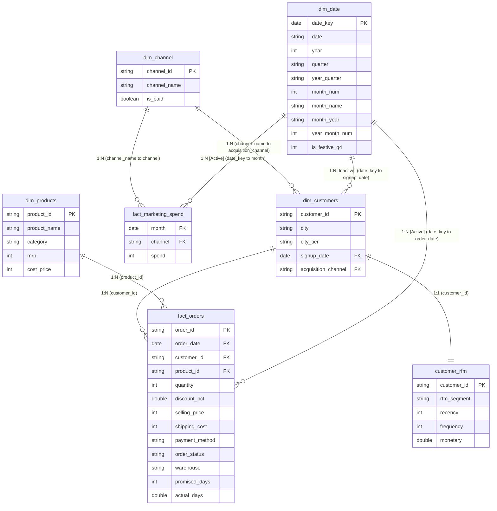

# Power BI Data Model Architecture: UrbanNest D2C Analytics

This document specifies the relational data model for the UrbanNest Power BI solution. It employs a star-schema architecture designed for query performance, predictable filter propagation, and robust DAX calculation.

---

## 1. Star Schema Architecture (Mermaid Diagram)



---

## 2. Relational Schema & Cardinality Specifications

| Relationship | Primary / Dimension Key | Foreign Key in Fact/Target | Cardinality | Cross Filter Direction | State | Description |
|---|---|---|---|---|---|---|
| **Orders by Customer** | `dim_customers[customer_id]` | `fact_orders[customer_id]` | 1 : Many (1:*) | Single (`dim_customers` filters `fact_orders`) | Active | Core customer slice |
| **Orders by Product** | `dim_products[product_id]` | `fact_orders[product_id]` | 1 : Many (1:*) | Single (`dim_products` filters `fact_orders`) | Active | SKU and Category slice |
| **Orders by Date** | `dim_date[date_key]` | `fact_orders[order_date]` | 1 : Many (1:*) | Single (`dim_date` filters `fact_orders`) | Active | Order transaction date context |
| **Spend by Date** | `dim_date[date_key]` | `fact_marketing_spend[month]` | 1 : Many (1:*) | Single (`dim_date` filters `fact_marketing_spend`) | Active | Monthly marketing spend context |
| **Customers by Channel** | `dim_channel[channel_name]` | `dim_customers[acquisition_channel]` | 1 : Many (1:*) | Single (`dim_channel` filters `dim_customers`) | Active | Conformed channel dimension |
| **Spend by Channel** | `dim_channel[channel_name]` | `fact_marketing_spend[channel]` | 1 : Many (1:*) | Single (`dim_channel` filters `fact_marketing_spend`) | Active | Conformed channel spend attribution |
| **Acquisition by Date** | `dim_date[date_key]` | `dim_customers[signup_date]` | 1 : Many (1:*) | Single | **Inactive** | Activated via `USERELATIONSHIP` for `New Customers` & `CAC` |
| **Customer RFM Mart** | `dim_customers[customer_id]` | `customer_rfm[customer_id]` | 1 : 1 | Both | Active | Complete 3,050 row 1:1 behavioral mart |

---

## 3. Channel Attribution & Filter Flow Dynamics

In traditional reporting models where `fact_marketing_spend` connects only to `dim_date`, slicing by acquisition channel does not propagate to ad spend, resulting in identical total spend figures across all channels.

### The `dim_channel` Solution:
1. `dim_channel` acts as a conformed dimension with 4 unique records: `Instagram Ads`, `Google Ads`, `Organic`, `Referral`.
2. When a visual or slicer filters on `dim_channel[channel_name]`:
   - Filter context propagates to `dim_customers` on `acquisition_channel`, which then filters `fact_orders` on `customer_id`. Consequently, `[Gross Revenue]` automatically aggregates only sales generated by customers acquired via that channel.
   - Concurrently, filter context propagates to `fact_marketing_spend` on `channel`, isolating the spend of that specific channel.
3. As a result, the measure `[ROAS] = DIVIDE([Gross Revenue], [Total Marketing Spend])` calculates the true channel-level Return on Ad Spend.

---

## 4. Inactive Date Relationship & New Customers Measure

`fact_orders` relates to `dim_date` on transaction date (`order_date`), which represents operational sales velocity. However, marketing efficiency (CAC) requires attributing marketing spend to the **signup/acquisition date** of new customers.

### Implementation:
- An inactive relationship is created between `dim_date[date_key]` and `dim_customers[signup_date]`.
- The measure `[New Customers]` activates this relationship dynamically:
  ```dax
  New Customers = 
  CALCULATE(
      DISTINCTCOUNT(dim_customers[customer_id]),
      USERELATIONSHIP(dim_date[date_key], dim_customers[signup_date])
  )
  ```
- The measure `[CAC]` uses this denominator:
  ```dax
  CAC = DIVIDE([Total Marketing Spend], [New Customers], 0)
  ```

---

## 5. Power BI Desktop Step-by-Step Configuration

1. **Mark Date Table:**
   - Select `dim_date`.
   - In the ribbon, click **Table Tools** > **Mark as Date Table** and select `date_key`.
   - Set column `month_year` to **Sort by Column** -> `year_month_num`.

2. **Organize Measures Table:**
   - On the Home tab, click **Enter Data**, name the table `_Measures`, and click Load.
   - Copy all measures from `powerbi/measures.dax` into `_Measures`.
   - Assign display folders (`01 Core Sales`, `02 Margins & Profit`, `03 Logistics & SLA`, `04 Marketing & Customers`, `05 Time Intelligence`, `06 UI & Formatting`).
   - Hide the placeholder column.

3. **Hide Foreign Keys & Internal Columns:**
   - Hide foreign keys in `fact_orders` (`customer_id`, `product_id`, `order_date`) from Report View so report authors slice using dimensions.
   - Set non-additive columns (e.g. `dim_date[year]`, `dim_products[mrp]`) to **Do Not Summarize**.
